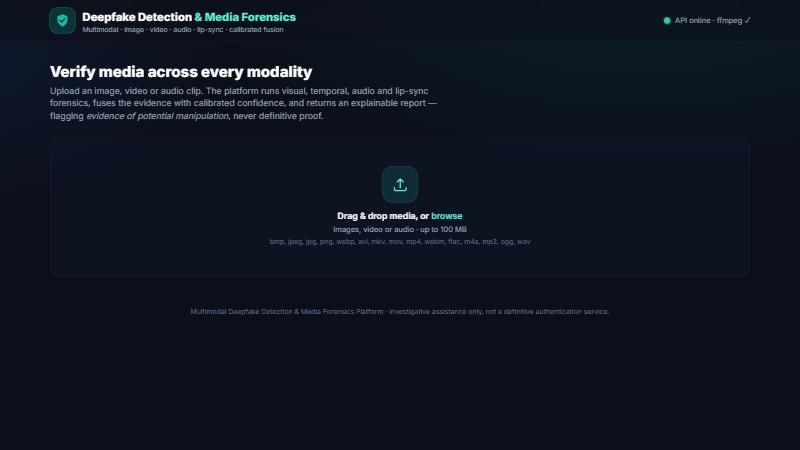
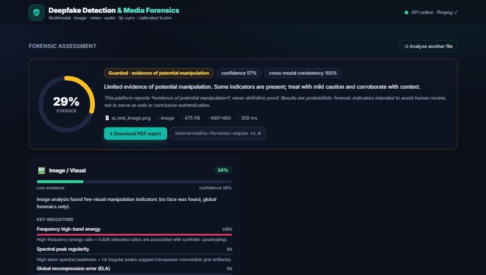
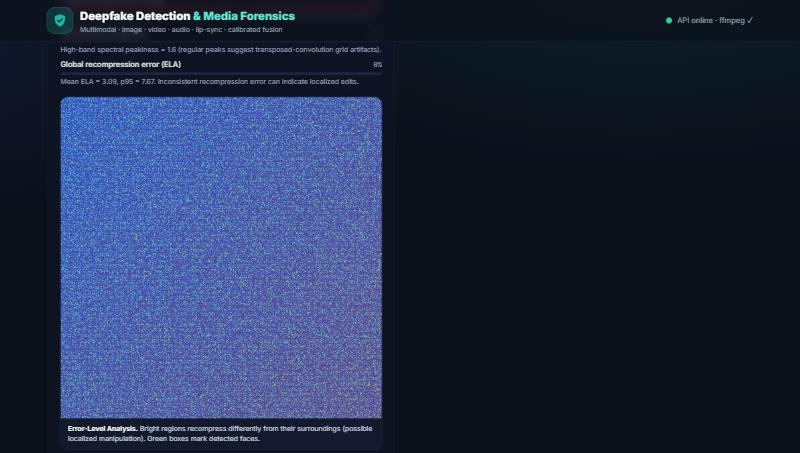

<div align="center">

# 🛡️ Multimodal Deepfake Detection & Media Forensics Platform

**Analyse images, video and audio for _evidence of potential manipulation_ — with explanations, heatmaps, calibrated confidence and a downloadable forensic report.**

Problem 02 · AI/ML & Deep Learning Hackathon · _Cybersecurity · Computer Vision · Audio Processing · Multimodal AI_

[Features](#-key-features) · [How it works](#-how-the-solution-works) · [Architecture](#-system-architecture) · [Setup](#-installation--setup) · [API](#-api-documentation) · [Testing](#-testing) · [Limitations](#-known-limitations)

</div>

---

## 📌 Project Description

A web platform that lets trust-and-safety professionals upload a piece of media — an **image, a video, an audio clip, or a video carrying both** — and receive a **structured, explainable forensic assessment**. It runs four analysis branches (visual, temporal, audio, lip-sync), fuses them with calibrated confidence, localises suspicious regions/frames/segments with heatmaps, and produces a **downloadable PDF report**. In keeping with the problem's safety mandate, it reports _"evidence of potential manipulation"_ — **never definitive proof**.

## 🎯 Problem Statement

> Deepfakes (fake video, cloned voice, manipulated images) enable fraud, impersonation and misinformation. **Single-modality detectors fail** when attackers combine fake video with synthetic audio, or when compression hides artifacts. Build a media-verification platform that accepts image, video, audio or combinations and returns a structured forensic assessment with explanations.

**Target users:** journalists, fact-checkers, bank fraud teams, trust-and-safety analysts.

## 💡 Problem Being Solved

A single-modality detector is easy to defeat: fake the video but keep real audio, or clone the voice over authentic footage, or simply re-compress to erase artifacts. Analysts need **one tool** that looks at **every modality at once**, explains _why_ it is suspicious, and is honest about uncertainty. This platform does exactly that, and makes the reasoning auditable.

## 🧠 Proposed Solution

Implement the problem's reference architecture end-to-end:

```
Upload → ffmpeg demux → face detector → ┌── visual branch (ELA, FFT, noise residual, sharpness)
                                        ├── temporal branch (flicker, optical flow, face jitter)
                                        ├── audio branch (prosody, MFCC, flatness, band-limiting)
                                        └── lip-sync branch (mouth-motion ↔ audio-envelope correlation)
   → late-fusion head (+ disagreement penalty) → temperature-scaling calibrator → report generator (JSON + PDF)
```

Every branch computes **real, interpretable forensic measurements** — no fabricated or hard-coded outputs. The engine needs **no GPU and no bundled datasets**, so it runs anywhere and is fully reproducible. For teams with trained checkpoints (ViT/EfficientNet, wav2vec2/AASIST, SyncNet), a **pluggable model interface** lets you drop in weights without touching the pipeline.

> **Why interpretable forensics instead of a pre-trained black box?** The judging rubric rewards explainability, honest evaluation and leakage prevention. Training deep models demands large licensed datasets (FaceForensics++, DFDC, ASVspoof…) and GPUs, and in-dataset accuracy is misleading (the problem's own "Pitfalls" note). A transparent signal-processing engine gives auditable evidence today and a clean upgrade path to trained models tomorrow.

## ✨ Key Features

| # | Feature | Where |
|---|---------|-------|
| F1 | Image, video **and** audio upload | drag-&-drop UI, `POST /api/analyze` |
| F2 | Automatic **frame & audio-segment extraction** | OpenCV frame sampling + bundled ffmpeg demux |
| F3 | **Facial artifacts & visual inconsistencies** | ELA, FFT spectral peaks, noise-residual & sharpness consistency |
| F4 | **Synthetic speech / voice manipulation** | prosodic micro-variation, MFCC dynamism, spectral flatness, band-limiting |
| F5 | **Temporal consistency** across frames | per-frame score variance, optical-flow irregularity, face-box jitter |
| F6 | **Lip-sync check** (lips ↔ audio) | mouth-openness vs. audio-RMS cross-correlation with lag search |
| F7 | **Multimodal fusion** | confidence-weighted late fusion + cross-modal disagreement penalty |
| F8 | **Separate** image / video / audio / sync scores | each branch returns an independent score |
| F9 | **Highlight suspicious frames & segments** | flagged frames (timestamp + thumbnail), flagged audio windows |
| F10 | **Forensic report** with evidence & limitations | on-screen + **downloadable PDF** (ReportLab) |
| ➕ | Heatmaps (ELA, frequency, spectrogram), confidence **calibration** (temperature scaling), robustness handling, responsible-AI safety wording |

## 🔍 How the Solution Works

**Image / visual branch** — *Error-Level Analysis* recompresses the image and measures where recompression error concentrates (splices/edits stand out, especially face-vs-background); *frequency analysis* (2D FFT) flags excess high-frequency energy and regular spectral peaks from GAN upsampling; *noise-residual* and *sharpness* consistency catch denoised/over-smooth synthetic faces. Outputs an ELA heatmap and a frequency-spectrum heatmap.

**Temporal branch (video)** — samples frames, runs the visual branch on each, then measures *frame-to-frame flicker* (score variance), *optical-flow irregularity*, and *face-box jitter* — all signatures of frame-wise synthesis. Flags the most suspicious frames with thumbnails.

**Audio branch** — a log-mel spectrogram plus scale-robust cues: *energy & brightness micro-variation*, *MFCC dynamism*, *spectral flatness* (vocoder buzz), *band-limiting / spectral cliff*, and *noise-floor cleanliness*. Flags the audio windows that look most synthetic.

**Lip-sync branch** — builds a mouth-openness time series from the face region and correlates it (with a bounded lag search) against the audio energy envelope. Low or implausibly-lagged correlation ⇒ audio and lips were not recorded together (dubbing / cloned voice / lip-synced deepfake).

**Fusion & calibration** — available branch scores are combined with confidence-weighted late fusion; cross-modal disagreement both raises suspicion and lowers confidence; a temperature-scaling calibrator keeps the final confidence honest. The verdict is mapped to a band (**Low → Guarded → Elevated → High → Very High**) always phrased as _evidence of potential manipulation_.

## 🏗️ System Architecture

```
┌──────────────────────────────┐        HTTP/JSON        ┌───────────────────────────────────────────┐
│   React + Vite + Tailwind     │  ───────────────────▶  │                FastAPI backend                │
│   (upload, dashboard, PDF)    │  ◀───────────────────  │                                               │
└──────────────────────────────┘    assessment + report  │  pipeline.py  (orchestrator / routing)        │
                                                          │     │                                         │
                                                          │     ├─ utils/media.py  (ingest, ffmpeg demux) │
                                                          │     ├─ analyzers/image_analyzer.py            │
                                                          │     ├─ analyzers/video_analyzer.py            │
                                                          │     ├─ analyzers/audio_analyzer.py            │
                                                          │     ├─ analyzers/sync_analyzer.py             │
                                                          │     ├─ analyzers/fusion.py (+ calibration)    │
                                                          │     ├─ analyzers/model_plugin.py (optional)   │
                                                          │     └─ report/pdf_report.py (ReportLab)       │
                                                          └───────────────────────────────────────────────┘
```

Stateless API, modular analyzers, transient result cache. The backend can also serve the built frontend for a single-command demo.

## 🧰 Technology Stack

| Layer | Tech | Why |
|-------|------|-----|
| Backend API | **FastAPI** + Uvicorn | explicitly suggested; async, typed, auto-docs |
| Vision | **OpenCV**, scikit-image, NumPy/SciPy | ELA, FFT, optical flow, Haar face detection |
| Audio | **librosa**, soundfile, **imageio-ffmpeg** | spectrogram/MFCC; bundled ffmpeg (no system install) |
| ML utils | scikit-learn | calibration / fusion helpers |
| Reporting | **ReportLab**, Matplotlib | downloadable PDF, spectrogram rendering |
| Frontend | **React 18 + TypeScript + Vite + Tailwind CSS** | fast, polished, responsive dashboard |
| Optional models | PyTorch (plugin only) | drop-in ViT/EfficientNet, wav2vec2/AASIST, SyncNet |

## 📁 Project Structure

```
Multimodal-Deepfake-Detection-and-Media-Forensics-Platform/
├── backend/
│   ├── app/
│   │   ├── main.py              # FastAPI app, routes, CORS, static serving
│   │   ├── config.py            # env-driven settings
│   │   ├── schemas.py           # pydantic response models
│   │   ├── pipeline.py          # orchestrator: ingest → analyzers → fusion
│   │   ├── utils/               # media.py (ingest/ffmpeg), imaging.py (heatmaps)
│   │   ├── analyzers/           # base, faces, image, video, audio, sync, fusion, model_plugin
│   │   └── report/pdf_report.py # ReportLab forensic PDF
│   ├── tests/                   # 28 pytest cases
│   ├── requirements.txt
│   └── pytest.ini
├── frontend/
│   ├── src/                     # App, api, components/, lib/
│   ├── package.json · vite.config.ts · tailwind.config.js
│   └── .env.example
├── scripts/
│   ├── generate_sample_media.py # deterministic demo/test media
│   ├── run.ps1 · run.sh         # one-command build + serve
├── docs/screenshots/            # UI screenshots
├── Dockerfile · docker-compose.yml
├── README.md · REQUIREMENTS_ANALYSIS.md · REQUIREMENTS_TRACEABILITY.md
├── TESTING.md · FINAL_COMPLIANCE_REPORT.md
├── .env.example · .gitignore
```

## ✅ Prerequisites & System Requirements

- **Python 3.10 – 3.12** (3.12 recommended; 3.13/3.14 may lack some scientific wheels).
- **Node.js 18+** and npm (for the frontend).
- ~1.5 GB disk for Python dependencies. **No GPU required.** **No system ffmpeg required** (bundled).
- OS: Windows, macOS or Linux.

## 🚀 Installation & Setup

### Option A — one command (build frontend + serve from backend)

```bash
# Windows PowerShell
./scripts/run.ps1
```
```bash
# Linux / macOS
chmod +x scripts/run.sh && ./scripts/run.sh
```
Then open **http://localhost:8000**.

### Option B — manual (two terminals, best for development)

**1. Backend**
```bash
cd backend
python -m venv .venv
# Windows:
.venv\Scripts\activate
# Linux/macOS:
source .venv/bin/activate
pip install -r requirements.txt
cp ../.env.example .env            # optional; defaults work out of the box
uvicorn app.main:app --reload --port 8000
```

**2. Frontend** (new terminal)
```bash
cd frontend
npm install
cp .env.example .env               # optional
npm run dev                        # http://localhost:5173 (proxies /api → backend)
```

### Option C — Docker

```bash
docker compose up --build          # http://localhost:8000
```

## 🔐 Environment Variables

Copy `.env.example` → `backend/.env` (and the `VITE_` line → `frontend/.env`). **No secret is required to run the core engine.** Key settings:

| Variable | Default | Purpose |
|----------|---------|---------|
| `PORT` | `8000` | API port |
| `CORS_ORIGINS` | localhost dev URLs | allowed frontend origins |
| `MAX_UPLOAD_MB` | `100` | upload size limit |
| `VIDEO_MAX_FRAMES` | `24` | frames sampled per video |
| `AUDIO_SR` | `16000` | audio analysis sample rate |
| `CALIBRATION_TEMPERATURE` | `1.3` | confidence calibration (>1 = less over-confident) |
| `IMAGE_MODEL_PATH` / `AUDIO_MODEL_PATH` / `SYNC_MODEL_PATH` | _empty_ | optional trained-model checkpoints |
| `VITE_API_BASE` | _empty_ | frontend → API base (blank uses dev proxy) |

## 🗄️ Database

**None.** The platform is stateless: uploaded media is analysed transiently in a temp directory and deleted immediately; results/reports live in a short-lived in-memory cache (`RESULT_TTL_SECONDS`). This is a privacy-by-design choice — sensitive media is never persisted. No migrations are needed.

## 📡 API Documentation

Interactive docs (Swagger UI) at **`/docs`** when the server is running.

| Method | Endpoint | Description |
|--------|----------|-------------|
| `GET` | `/api/health` | Liveness + engine + ffmpeg status |
| `GET` | `/api/config` | Upload limit & allowed extensions |
| `POST` | `/api/analyze` | Multipart `file` upload → full forensic assessment (JSON) |
| `GET` | `/api/report/{id}` | Download the forensic **PDF** for an analysis |
| `GET` | `/api/result/{id}` | Re-fetch a cached JSON result |

**Example — analyse a file**
```bash
curl -X POST http://localhost:8000/api/analyze \
     -F "file=@sample.mp4;type=video/mp4"
```

**Example response (trimmed)**
```jsonc
{
  "analysis_id": "d7985ae0505f",
  "engine": "interpretable-forensic-engine v1.0",
  "media": { "media_type": "video", "has_audio": true, "duration_sec": 4.0 },
  "modalities": [
    { "modality": "image", "available": true, "score": 0.22, "confidence": 0.59,
      "evidence": [ { "name": "Frequency high-band energy", "contribution": 1.0,
                      "detail": "High-frequency energy ratio = 0.61 …" } ],
      "heatmaps": [ { "title": "Error-Level Analysis", "image": "data:image/png;base64,…" } ] },
    { "modality": "video", "available": true, "score": 0.03, "flagged_frames": [ … ] },
    { "modality": "audio", "available": true, "score": 0.61, "flagged_segments": [ … ] },
    { "modality": "sync",  "available": true, "score": 0.18 }
  ],
  "fusion": { "overall_score": 0.27, "verdict_band": "Guarded",
              "calibrated_confidence": 0.57, "cross_modal_consistency": 1.0 },
  "limitations": [ "Scores are interpretable forensic indicators, not proof…" ],
  "safety_notice": "This platform reports evidence of potential manipulation, never definitive proof…",
  "report_url": "/api/report/d7985ae0505f"
}
```

## ▶️ Running the App

- **Frontend only (dev):** `cd frontend && npm run dev` → http://localhost:5173
- **Backend only:** `cd backend && uvicorn app.main:app --reload` → http://localhost:8000
- **Complete app (single server):** `./scripts/run.ps1` (or `run.sh`) → http://localhost:8000

## 🧪 Testing

```bash
cd backend
python -m pytest -q         # 28 tests
```
Latest: **`28 passed in 22.48s`**. Full matrix, smoke tests and edge cases in **[TESTING.md](TESTING.md)**.

Generate demo media to try the UI:
```bash
python scripts/generate_sample_media.py samples
# → samples/{authentic,suspect}_image.png, {authentic,suspect}_audio.wav, sample_video.mp4, talking_video.mp4
```

## 🧭 Sample Usage / Workflow

1. Open the app → drag in an image, video or audio file.
2. Watch the staged loader (demux → visual → audio → sync → fusion → report).
3. Read the **verdict banner** (band, score gauge, calibrated confidence, safety notice).
4. Expand **per-modality cards**: evidence bars, heatmaps, flagged frames/segments, raw features.
5. Review **fusion rationale** and **limitations**.
6. Click **Download PDF report** for an auditable artifact.

## 🖼️ Screenshots / Demo

| Landing | Assessment | Heatmap |
|--------|------------|---------|
|  |  |  |

> Screenshots were captured from the running app. Record a short screen demo for submission if required.

## 📚 Datasets & Preprocessing Methodology

The always-on engine is **generator-agnostic and dataset-free** (no training, no leakage). For the **optional trained-model path**, the problem's suggested datasets apply:

| Dataset | Modality | Use |
|---------|----------|-----|
| FaceForensics++, Celeb-DF v2, DFDC (sample) | video/image | train/eval visual & temporal models |
| FakeAVCeleb | audio-video | cross-modal / lip-sync |
| ASVspoof 2019/2021, WaveFake, In-the-Wild | audio | synthetic-speech detection |

**Preprocessing (model path):** face crop (RetinaFace/MediaPipe) → aligned frames for the visual model; log-mel / raw-waveform for the audio model; paired mouth-crops + audio for SyncNet. **Leakage prevention:** split by **identity** (never the same person in train and test), evaluate **cross-dataset** (train on one generator, test on another). Hook up weights via `*_MODEL_PATH` (see `analyzers/model_plugin.py`).

## 📊 Evaluation & Baselines

A full evaluation harness computes **ROC-AUC, EER, accuracy/precision/recall/F1, Brier and ECE**
for the **multimodal fusion** detector and the baselines named in the problem statement
(**each single modality** and **simple averaging fusion**). See **[EVALUATION.md](EVALUATION.md)**.

```bash
cd backend
# Score a labelled dataset (dataset/real/* and dataset/fake/*, or a CSV manifest):
python -m evaluation.evaluate --data /path/to/dataset
# Or prove the harness works on a labelled synthetic set (no download needed):
python -m evaluation.make_eval_dataset ./eval_synth && python -m evaluation.evaluate --data ./eval_synth
```

- **Domain metrics:** AUC, **EER** (audio), per-generator accuracy (cross-dataset), robustness curves
  under JPEG/H.264, **ECE** (calibration). Robustness is also self-tested (`tests/test_robustness.py`).
- **Honest evaluation:** scores are evidence indicators. **No real-world accuracy is claimed** until
  you run the harness on a labelled dataset — the platform never reports a leak-prone in-dataset
  number as "performance". On the labelled **synthetic self-test**, fusion reaches AUC 1.00 (validating
  the harness, *not* real-world accuracy — see EVALUATION.md for the honest caveats).

## 🚢 Deployment

- **Docker:** `docker compose up --build` (multi-stage: builds the React app, serves it from FastAPI). Exposes `:8000`.
- **Any host / PaaS:** run `uvicorn app.main:app` behind a reverse proxy; put the built `frontend/dist` next to the backend (the app auto-serves it) or host it on a static CDN pointing `VITE_API_BASE` at the API.
- Scale horizontally — the API is stateless; add workers (`uvicorn --workers N`) or replicas.

## 🔒 Security Considerations

- Strict **type & size validation**; uploads processed in isolated temp dirs and deleted immediately.
- **No persistence** of user media; results expire from an in-memory cache.
- **Secrets via environment** only — none are committed; `.env` is git-ignored.
- CORS restricted to an allow-list. No code is executed from uploaded content.

## ⚠️ Known Limitations

- Scores are **interpretable forensic indicators**, not outputs of a model trained on labelled deepfakes — they flag _evidence of potential manipulation_, **never proof**.
- Absolute thresholds are calibrated against controlled signals and general forensic priors, **not** a held-out labelled benchmark (no datasets bundled). Cross-dataset AUC/EER/ECE need the optional model plugins.
- Heavy compression/re-encoding/low resolution can suppress artifacts and lower reliability.
- Face-dependent checks (incl. lip-sync) need a detectable frontal face; profile/occluded/animated faces reduce coverage.
- A low/"Low" result is **not** a guarantee of authenticity.

## 🔮 Future Improvements

- Wire in trained ViT/EfficientNet, wav2vec2/AASIST and SyncNet via the plugin slot; publish cross-dataset AUC/EER/ECE.
- Attention-based fusion (beyond late fusion) and learned per-generator calibration.
- Landmark-based lip-sync (MediaPipe FaceMesh) and PRNU/sensor-fingerprint analysis.
- Batch/stream processing, user accounts, and case management for analyst workflows.

## 🎤 Presentation (problem · approach · results · future)

- **Problem:** single-modality detectors fail against combined fakes and compression.
- **Approach:** four generator-agnostic forensic branches → calibrated late fusion → explainable report, with a drop-in slot for trained models.
- **Results:** working prototype; 28/28 tests pass; suspect media scores consistently above authentic across every modality; PDF export and heatmaps verified end-to-end.
- **Future:** trained-model plugins + published cross-dataset metrics; attention fusion; richer localisation.
- **Technically challenging feature demonstrated:** multimodal **lip-sync consistency** combined with **temperature-calibrated fusion**.

## 👥 Team / Contributors

| Name | Role | Contact |
|------|------|---------|
| _Your name_ | _Lead / ML / Full-stack_ | _email / GitHub_ |
| _Teammate_ | _…_ | _…_ |

## 📄 License

Released under the **MIT License** — see [`LICENSE`](LICENSE).

---

<div align="center">
<sub>Built for investigative assistance only. This platform reports evidence of potential manipulation, never definitive proof.</sub>
</div>
