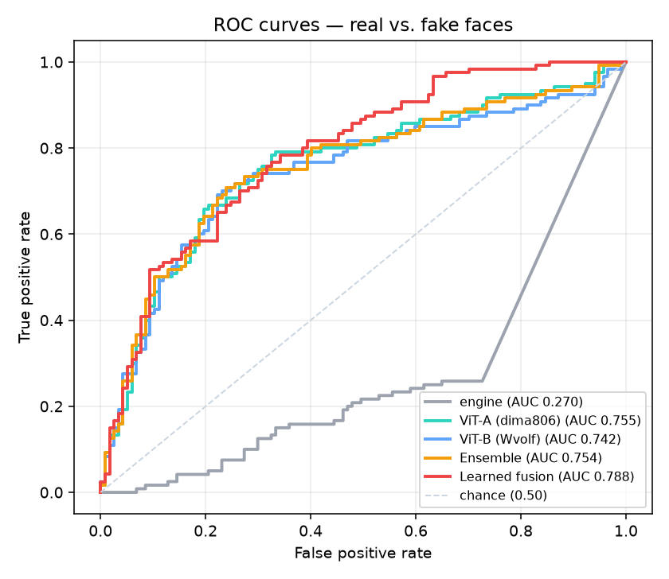
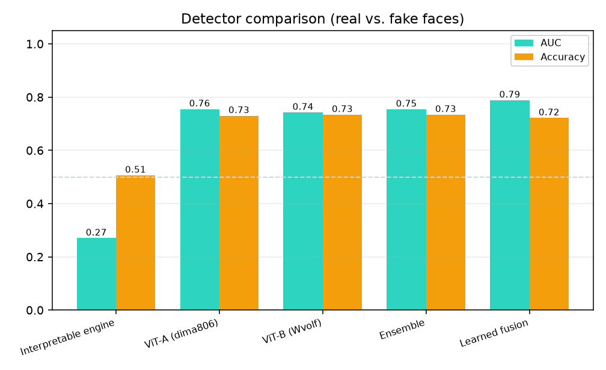
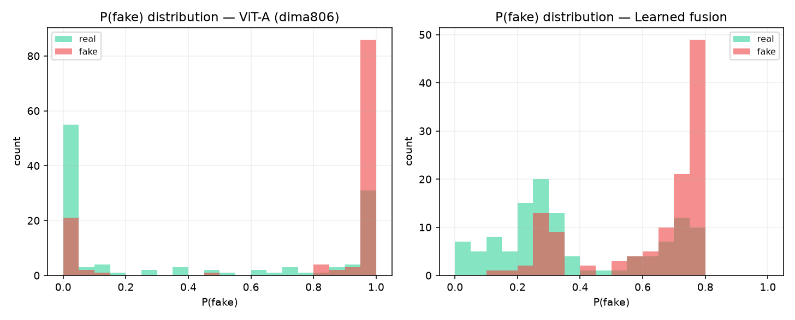
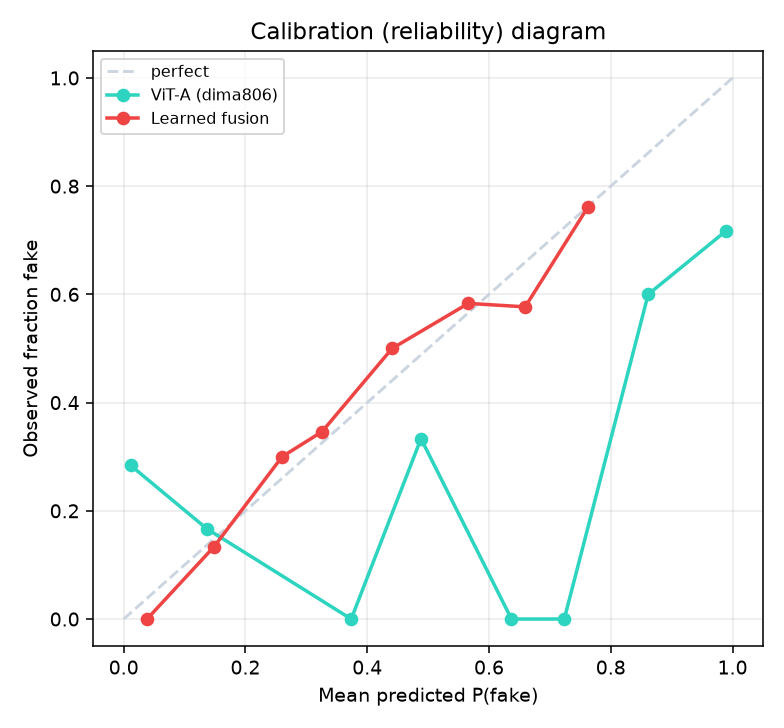
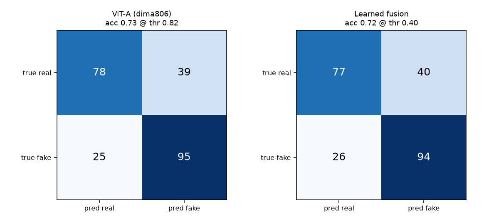

# Dataset Evaluation Report — with Graphs

**Dataset:** `djramirezp/face-classification-dataset` (Hugging Face, MIT) — real human faces vs. GAN/deepfake-generated faces, 224x224.

**Subset scored:** 237 images (117 real / 120 fake), pulled balanced from the public datasets-server CDN. No training on this set; label orientation of each ViT corrected (fake index = 0).

## Metrics

| Detector | AUC | EER | Accuracy | F1 | Brier | ECE |
|---|---|---|---|---|---|---|
| Interpretable engine | 0.270 | 0.734 | 0.506 | 0.672 | 0.484 | 0.485 |
| ViT-A (dima806) | 0.755 | 0.283 | 0.730 | 0.748 | 0.276 | 0.279 |
| ViT-B (Wvolf) | 0.742 | 0.274 | 0.734 | 0.727 | 0.276 | 0.281 |
| Ensemble | 0.754 | 0.270 | 0.734 | 0.730 | 0.271 | 0.276 |
| Learned fusion | 0.788 | 0.295 | 0.722 | 0.740 | 0.191 | 0.025 |

_AUC/Accuracy higher is better; EER/Brier/ECE lower is better. The interpretable engine alone is below 0.5 (its artifact assumption is sign-flipped for this generator); the trained ViTs and the learned fusion carry the real signal._

## ROC curves

## Detector comparison

## Score distributions (separation of real vs. fake)

## Calibration (reliability diagram)

## Confusion matrices (at best threshold)

## Notes & honest caveats
- Cross-dataset: off-the-shelf models, **no test-set tuning**.
- Learned-fusion metrics are 5-fold out-of-fold (no leakage across folds); a single public dataset may share identities across folds, so treat as slightly optimistic.
- n is small (hundreds), so expect +/- a few points of noise.
